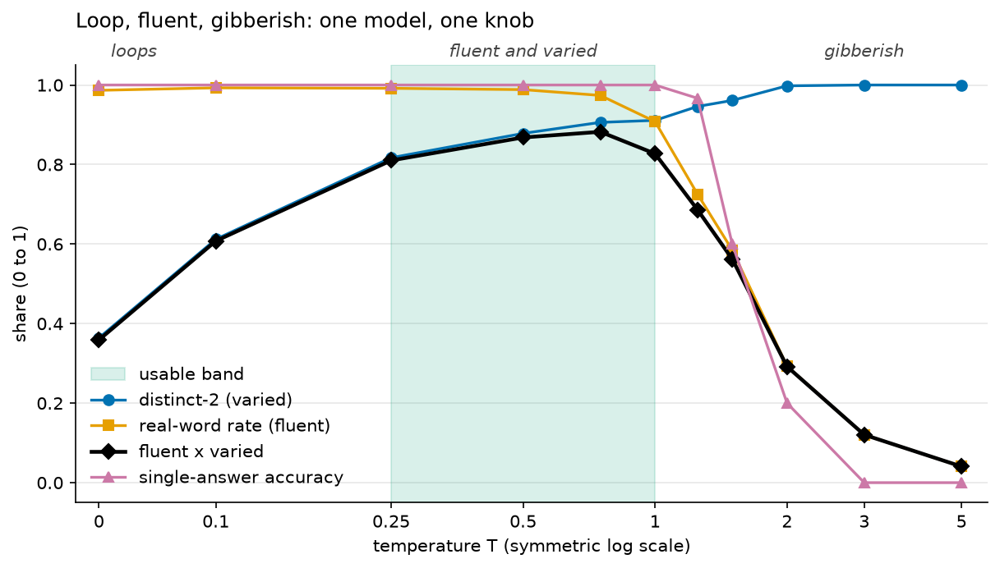

# decoding_101

**Your model already knows the answer. The sampler decides what it says.**

A hands-on introduction to decoding, the step that turns a language model's probabilities into actual text, built from scratch on CPU.

A language model does one thing: given the text so far, it outputs a probability for every possible next token. Everything after that (greedy, temperature, top-k, top-p, beam search, repetition penalties) is a few lines of sampler code that you control. This project builds each of those decoders from scratch, holds the model fixed, and measures what each one does to the same distribution.



*One frozen model, one knob. Temperature divides the logits before the softmax. At T = 0 the output loops, around T = 0.25–1 it is fluent and varied, and above T = 2 it stops being words.*

## What it shows

Every number below comes from the executed notebooks (`outputs/results/*.json`, seed 42). *Fluent* is the share of generated words that are real words; *varied* is distinct-2, unique word pairs divided by all word pairs.

| Finding | Evidence |
|---|---|
| **Greedy loops, and that is the decoder's fault, not the model's.** | On the char model, all 5 open-ended prompts fall into the *same* 66-character cycle (distinct-2 0.36). On distilgpt2, greedy scores distinct-2 0.13 on two prompts; a repetition penalty or nucleus sampling lifts that to 0.94–1.00 without touching the model. |
| **Temperature is one line: `logits / T`.** | Real-word rate is 0.99 at T = 0.25, 0.29 at T = 2 and 0.04 at T = 5. T → 0 reproduces greedy token for token; T → ∞ is uniform to within 1e-6. |
| **Nucleus cuts the tail that produces gibberish.** | At T = 1.5 the real-word rate is 0.58 with no cut, 0.71 with top-k = 5 and 0.95 with top-p = 0.8. After "The United States of", top-p 0.9 keeps 1 of distilgpt2's 50,257 tokens; after "I like" it keeps 1,730. A fixed k = 50 keeps 50 either way. |
| **Beam search wins single answers and loses open-ended text.** | Greedy and beam answer 100% of the fact prompts (on distilgpt2 too: 100% against 44% for nucleus and 0% at T = 1.5), but on open-ended text they score 0.36 and 0.61 on fluent × varied, against 0.85 for top-p 0.8. |
| **Penalties work within a range.** | A repetition penalty up to 1.2 cuts greedy's repetition at no cost. At 1.5, fact accuracy falls to 0.83 and at 2.0 to 0.33, because the answer's letters already appear in the prompt and get penalised. |
| **The from-scratch decoders match the library.** | Temperature, top-k, top-p and repetition penalty match the `transformers` warpers bit for bit. Greedy and beam search match `model.generate()` token for token, including EOS handling and length penalties. |

## The notebooks

| | Notebook | The point |
|---|---|---|
| 01 | [Logits to text](notebooks/01_logits_to_text.ipynb) | The model outputs one fixed vector of logits; choosing a token is a separate, swappable step. |
| 02 | [Greedy and the loop](notebooks/02_greedy_and_the_loop.ipynb) | With a fixed context window, greedy is a finite-state machine, so it has to cycle, and the model is confident at almost every step of the loop. |
| 03 | [Temperature is one line](notebooks/03_temperature_is_one_line.ipynb) | `logits / T`. Entropy rises monotonically with T, and a sweep finds the usable band. *(Showpiece.)* |
| 04 | [Top-k and nucleus](notebooks/04_top_k_and_nucleus.ipynb) | Cutting the tail. A fixed k ignores how confident the model is; nucleus adapts. Both are checked bit for bit against `transformers`. |
| 05 | [Beam search](notebooks/05_beam_search.ipynb) | Wider beams find more probable text, not more varied text. The decoder that wins one task loses the other. |
| 06 | [Decision framework](notebooks/06_decision_framework.ipynb) | The rules, the evidence for them, how top-p shifts the temperature band, the penalty sweep, and decoders to copy. |

The rules from notebook 06:

| Task | Use |
|---|---|
| One correct answer (translation, extraction, classification, structured output) | greedy, or beam search with B = 4, at temperature 0 |
| Open-ended (stories, brainstorming, dialogue) | nucleus with top-p 0.8–0.95, temperature 0.7–1.0 |
| Open-ended text that loops | the above plus a repetition penalty of 1.1–1.3, or a frequency penalty of about 0.1 |

## Quickstart

Everything runs on CPU. It was developed on a 2-core, 8 GB GitHub Codespace with no GPU.

```bash
make setup      # installs uv if needed, syncs dependencies (CPU-only torch), registers the kernel
make test       # 108 tests, about 30 s; one test needs the Hugging Face Hub
make notebooks  # runs all six notebooks in place, about 6.5 min; distilgpt2 downloads once (~350 MB)
make run        # the Streamlit app at http://localhost:8501
```

Other targets: `make ci` (sync + lint + test), `make test-offline` (no network), `make lab` (JupyterLab), `make models` (optional Ollama model). `make help` lists them all.

Using the decoders directly:

```python
from src.decoders import BeamSearch, Decoder, make_generator
from src.model import load_model

model = load_model("char")                       # or "hf" for distilgpt2
ids = model.encode("the keeper")
for decoder in [Decoder.greedy(), Decoder(temperature=0.8, top_p=0.9), BeamSearch(4)]:
    out = decoder.generate(model, ids, 120, generator=make_generator(42))
    print(decoder.label, model.decode(out[0, ids.size(1):]))
```

## How it works

**Two models, so the project is both transparent and realistic.**

- A **from-scratch character model**: an MLP over the last 8 characters, 57,557 parameters, trained in a few seconds on a built-in corpus of original stories and facts. Its vocabulary is 29 characters, so its entire next-token distribution fits on one chart. The context of 8 is deliberate: it is short enough that greedy decoding visibly cycles, and long enough that every fact is memorised.
- **distilgpt2** (82M parameters, 50,257 subword tokens) for genuine English.
- An optional local Ollama model can be driven with the same settings, but it returns text only, never logits, so nothing depends on it.

**One pipeline, in the same order as `transformers.generate`:**

```
penalties → temperature → top-k → top-p → softmax → pick (argmax or sample)
```

Each step is a pure `logits → logits` function that masks removed tokens with `-inf`. The whole generation loop is about ten lines in `src/decoders/__init__.py`.

**Measured, not eyeballed.** Each decoder is scored on repetition (distinct-n, longest repeated span), fluency (real-word rate), likelihood under the unchanged model, diversity across samples, and accuracy on single-answer prompts. The open-ended and single-answer prompt sets are matched, so the quality-versus-diversity trade-off is measured rather than claimed.

**The app** has four tabs: a distribution viewer (watch temperature, top-k and top-p reshape the distribution), a decoder race (seven decoders on one prompt, side by side), a temperature sweep, and a task matcher.

**Outputs.** `outputs/figures/` holds the 17 figures as PNG. `outputs/results/` holds the numbers and generated text behind them as JSON, one file per figure under the same name, each recording its seed.

## Project structure

```
src/
  decoders/      greedy, temperature, top_k, top_p, beam, penalties; Decoder + generate() in __init__
  model/         char_lm (from scratch), logits (distilgpt2 wrapper, optional Ollama)
  analysis/      distribution (entropy, top mass), repetition (distinct-n, cycles), diversity
  datasets/      corpus for the char model; open-ended and single-answer prompts
  evaluation/    vs_reference (checks against transformers), comparison (the decoder arena)
  visualisation.py, results.py, config.py
app/             streamlit_app.py
notebooks/       01–06, committed with their outputs
config/          settings.yaml: every temperature, k, p, beam width and seed
tests/           108 tests (96% coverage), with recorded distilgpt2 logits for offline runs
outputs/         figures/*.png and results/*.json
```

## Limitations

- The models are tiny, so the generated text is weak in absolute terms. The claims are about how decoders reshape a *fixed* distribution, and those hold at any model size.
- The repetition metrics work on words. Loops made of something else, such as runs of blank lines or repeated symbols (beam search on distilgpt2 produces both), go unmeasured. The notebooks point these out where they occur.
- Fluency as "share of real words" needs a vocabulary, so it is measured on the char model only. Real-model results rely on repetition, accuracy and reading the text.
- The optional Ollama client has not been run against a live server.

## Related projects

Other "101" and "arena" projects, each built on CPU:

**Where the logits come from**

- [tokenization_101](https://github.com/Dima806/tokenization_101): how text becomes tokens, with byte-pair encoding built from scratch. Every decoder here chooses among tokens, not words.
- [embeddings_101](https://github.com/Dima806/embeddings_101): the representations underneath language models, from co-occurrence counts to word2vec and sentence encoders.
- [transformers_101](https://github.com/Dima806/transformers_101): the architecture that produces next-token logits, built from scratch in numpy.
- [backprop_101](https://github.com/Dima806/backprop_101): the algorithm that trains every neural network, this project's char model included, built without a deep-learning framework.

**Ideas that decoding borrows**

- [sampling_101](https://github.com/Dima806/sampling_101): drawing random samples correctly. Every sampling decoder here makes one categorical draw per step.
- [information_theory_101](https://github.com/Dima806/information_theory_101): entropy and cross-entropy, used here to measure how peaked a distribution is and how likely a text is.
- [bandits_101](https://github.com/Dima806/bandits_101): the explore-exploit trade-off, from epsilon-greedy to Thompson sampling. Greedy decoding is pure exploitation; sampling is exploration.
- [calibration_arena](https://github.com/Dima806/calibration_arena): calibration methods, temperature scaling among them. It is the same divide-the-logits-by-T step, used to correct confidence rather than to shape text.

**Language models in practice**

- [quantization_101](https://github.com/Dima806/quantization_101): shrinking a model to a quarter of its size so it runs on a laptop.
- [lora_101](https://github.com/Dima806/lora_101): low-rank adaptation, the technique that made fine-tuning large models affordable.
- [rag_101](https://github.com/Dima806/rag_101): retrieval-augmented generation with tiny local models. The generator at the end is a decoder like the ones here.
- [llm_judge_benchmark](https://github.com/Dima806/llm_judge_benchmark): local LLM judges compared with human annotation, using the CPU Ollama setup this project can optionally reuse.

All projects: [github.com/Dima806](https://github.com/Dima806).

## References

- Holtzman, A. et al. (2020). The Curious Case of Neural Text Degeneration. *ICLR.* (Nucleus sampling and the greedy loop.)
- Fan, A., Lewis, M. and Dauphin, Y. (2018). Hierarchical Neural Story Generation. *ACL.* (Top-k sampling.)
- Keskar, N. S. et al. (2019). CTRL: A Conditional Transformer Language Model for Controllable Generation. *arXiv:1909.05858.* (The repetition penalty.)
- Freitag, M. and Al-Onaizan, Y. (2017). Beam Search Strategies for Neural Machine Translation. *ACL Workshop on NMT.*
- Vijayakumar, A. et al. (2018). Diverse Beam Search. *AAAI.*
- Meister, C. et al. (2023). Locally Typical Sampling. *TACL.*
- Welleck, S. et al. (2020). Neural Text Generation with Unlikelihood Training. *ICLR.*

## License

Apache-2.0. See [LICENSE](LICENSE).
